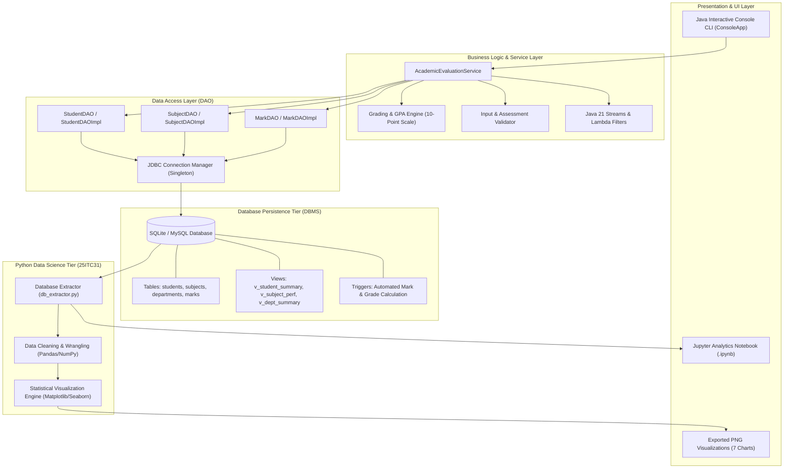
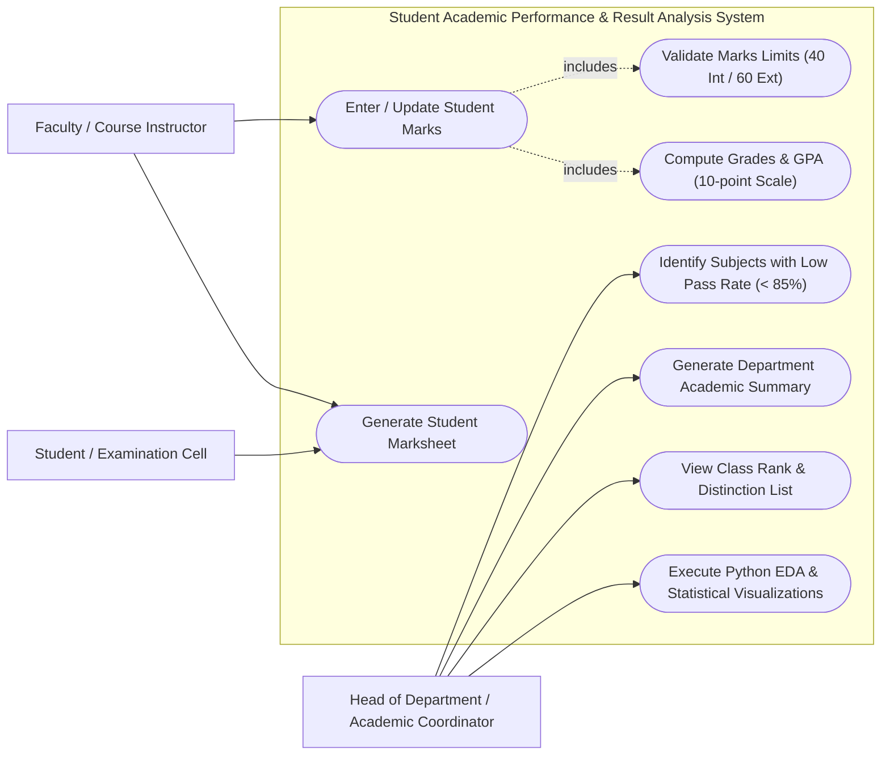
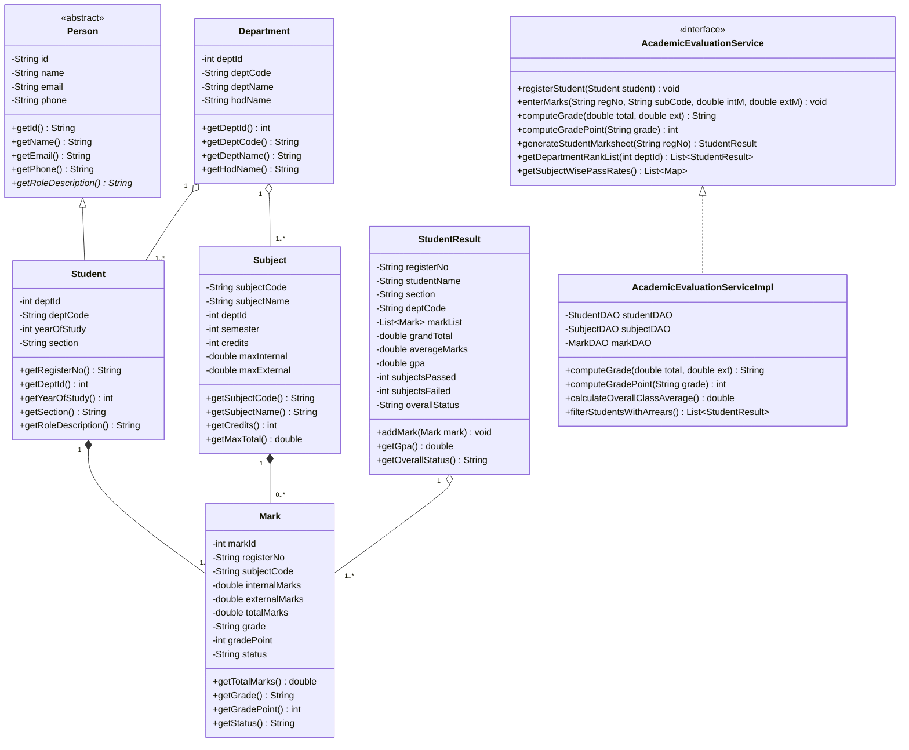
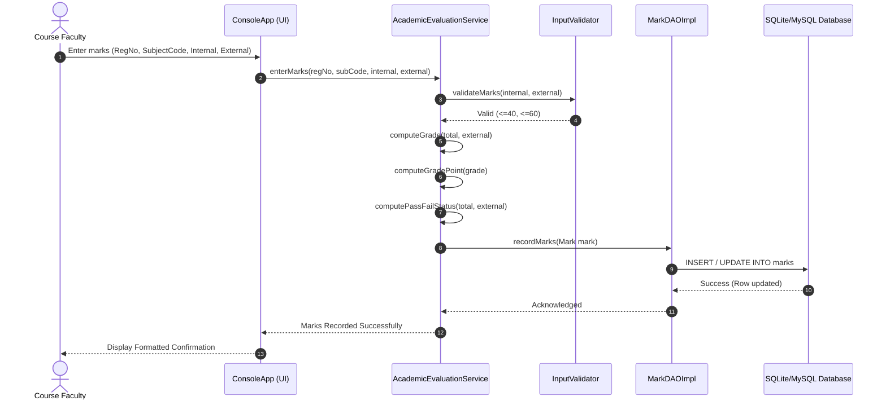
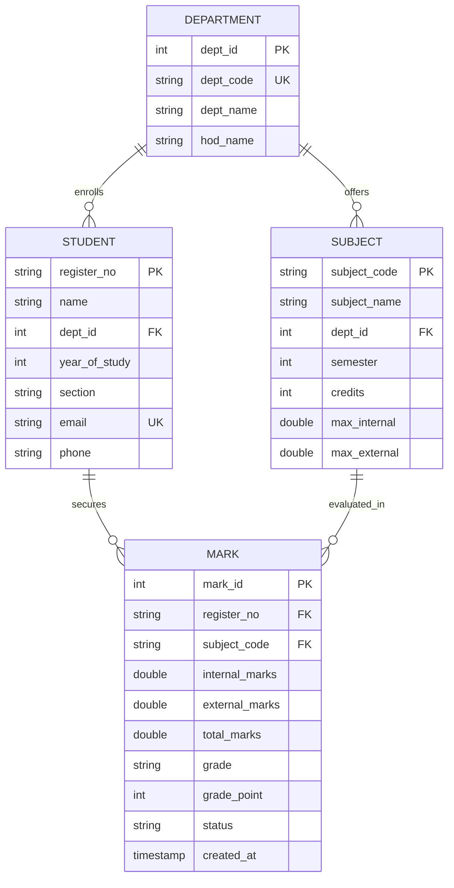
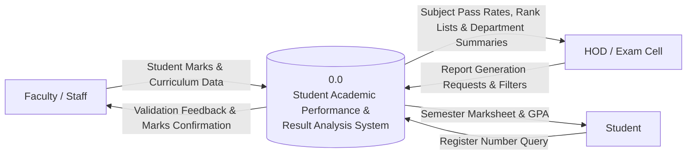
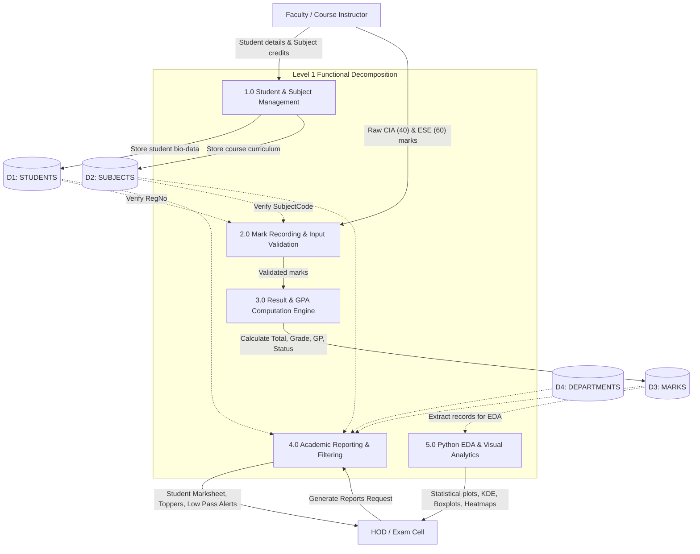
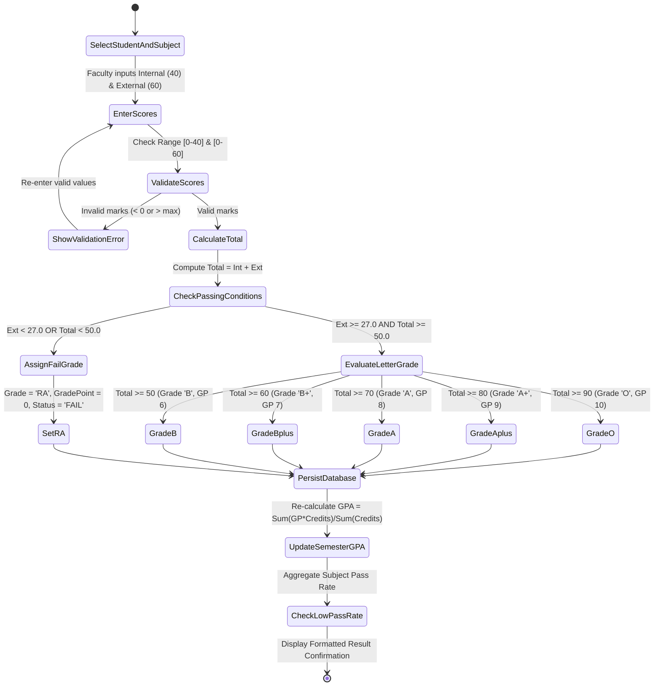

# System Design Diagrams
## Student Academic Performance and Result Analysis System

**Institution:** Velalar College of Engineering and Technology, Erode - 12  
**Department:** Department of Information Technology  
**Academic Year:** 2026-27 (ODD) | **Class:** 25IT3A&B  
**Course Code & Title:** 25ITT33 - Software Engineering & 25ITT31 - DBMS  
**Scenario Assigned:** Scenario 8  
**Author:** Jaswanth surya S | **Reg No:** 732925ITR038 | **Class:** 25IT3A  

---

## 1. Overall System Architecture

The system utilizes an integrated **3-Tier Layered MVC Architecture** spanning Java Enterprise OOP, Relational DBMS, and Python Data Science Pipeline.



---

## 2. Use Case Diagram



---

## 3. Class Diagram (UML)



---

## 4. Sequence Diagram: Mark Entry and Result Computation Flow



---

## 5. Entity-Relationship (ER) Diagram



---

## 6. Relational Model / Schema Representation

```text
DEPARTMENTS (
    dept_id (PK),
    dept_code (UNIQUE),
    dept_name,
    hod_name
)

STUDENTS (
    register_no (PK),
    name,
    dept_id (FK -> DEPARTMENTS.dept_id),
    year_of_study,
    section,
    email (UNIQUE),
    phone
)

SUBJECTS (
    subject_code (PK),
    subject_name,
    dept_id (FK -> DEPARTMENTS.dept_id),
    semester,
    credits,
    max_internal,
    max_external
)

MARKS (
    mark_id (PK),
    register_no (FK -> STUDENTS.register_no),
    subject_code (FK -> SUBJECTS.subject_code),
    internal_marks,
    external_marks,
    total_marks,
    grade,
    grade_point,
    status,
    created_at,
    UNIQUE(register_no, subject_code)
)
```

---

## 7. Data Flow Diagrams (DFD)

### 7.1 DFD Level 0 (Context Level Diagram)
The Level 0 context diagram demonstrates external entities interacting with the centralized academic system boundary.



### 7.2 DFD Level 1 (Detailed Subsystem Flow)
Level 1 decomposes the system into functional processes: Student Management, Subject Mapping, Mark Entry & Validation, Result & GPA Engine, and Python Data Science Analytics.



---

## 8. Activity Diagram: Mark Entry and Result Processing Workflow



